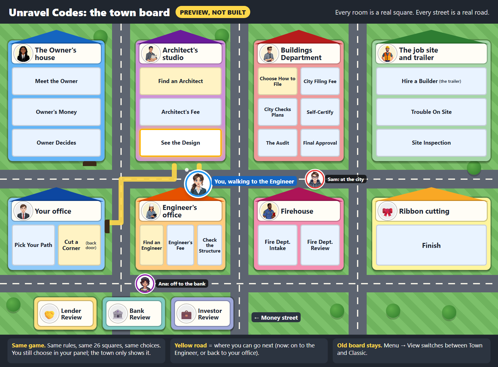
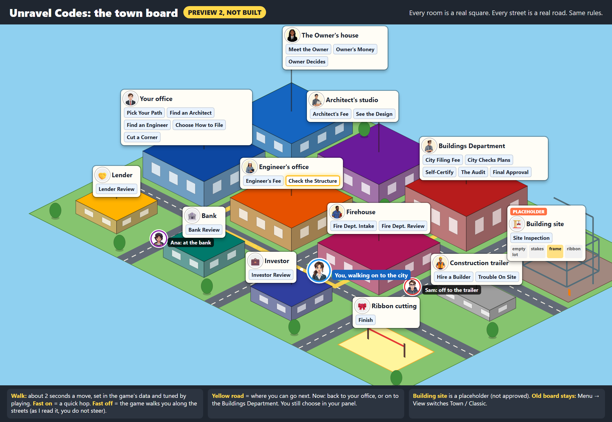

# The town board idea: a review

Written 2026-10-11 by the Game session (Claude Code, folder `D:\Unravel\Current_Game\Game_Alpha`), from the Manager's brief of the same day. **This is a review only. No code was changed, nothing was committed or deployed.** The game that was looked at is v3.7.5, which is live.

Everything Tom needs is in parts 1 to 9, in plain words. Part 10 is for whoever builds it later, and Tom can skip it.

---

## First-build plan (added 2026-10-11, after preview 2). PLAN ONLY, nothing is built.

**What Tom approved to plan:** the town look plus a short walk the game does for you (review Steps 1 and 2). Not in this plan: the clipboard look, your own growing building, little scenes, steering, and the road jokes.

### How the town is laid out (Tom's final layout, checked against the real squares)

| Building | Rooms (real squares) |
|---|---|
| Your office | Pick Your Path, Find an Architect, Find an Engineer, Lender Review, Cut a Corner |
| The Owner's house | Meet the Owner, Owner's Money, Owner Decides |
| Bank | Bank Review |
| Investor | Investor Review |
| Architect's studio | Architect's Fee, See the Design |
| Engineer's office | Engineer's Fee, Check the Structure |
| Buildings Department | Choose How to File (Tom, 2026-10-11: "move it back"), City Filing Fee, City Checks Plans, Self-Certify, The Audit, Final Approval |
| Firehouse | Fire Dept. Intake, Fire Dept. Review |
| Construction trailer | Hire a Builder, Trouble On Site |
| Building site | Site Inspection (the building itself is a placeholder) |
| Ribbon cutting | Finish |

That is all 26 squares, each in one place. ("Quick Play" is never entered, so it has no building.) No rule changes.

**What this layout does to the roads. Nothing breaks, but four things will look different from today:**
1. **"Sent back to the architect" now walks you to your office**, not to the architect's studio. The square the examiner sends you to is "Find an Architect", which is now in your office. The same goes for being sent back to the engineer. It reads as "back to the office to find one again". Fine if you are happy with that picture.
2. **Filing stays in one building** (Tom: "move it back"): Choose How to File is in the Buildings Department lobby, so filing is room to room, not two trips across town.
3. **Many moves become room-to-room inside one building**: Pick Your Path to Lender Review, Find an Architect, Find an Engineer or Cut a Corner; Owner's Money to Owner Decides; Architect's Fee to See the Design. Those get a short hop inside the building, not a street walk. That makes games quicker than the "2 seconds every move" estimate.
4. **The door to the bank from Hire a Builder** becomes a walk from the trailer to your office (Lender Review), then on to the Bank. That reads well: "go back and get more money".

**Things that must keep working:**
- **The admin board editor and the in-game edit mode always use the classic board.** The town never appears while someone is moving squares.
- **A teacher's board with an added square:** if the town list does not name the square, it goes into the building of its speaking character. If it has no character, it gets a small "new place" lot of its own, with its name on it. A teacher's board with no town list at all just shows the classic board.
- **Several players in one room:** their faces line up on the doorstep, as today in a square.
- **"Check my board" and the practice bot** play with no screen, so the town cannot affect them.

### How the details open (Tom: "location names only, rooms on hover or click")
- **Every screen, by default:** each building shows only its name (and later its picture).
- **PC:** hover over a building to see its rooms; click to keep it open; click again to close. The board already has a hover timer and a click-to-open, so these are reused.
- **TV:** no hover and nobody taps it, so **the building the current player is in opens by itself**, and the next places they can go light up. The camera already glides to the current player on the TV today; the town adds "open that building".
- **Remote screen strip:** tap a building to open it, tap again to close.
- **The player panel and the phones stay exactly as they are.** The phones are controllers.

### The steps, in order

**How the cost numbers were made:** this whole review plus two pictures used about 22 points of the 5-hour meter and 2 points of the week. A building session costs more, because it writes code, runs about 3,800 tests and checks the screens in a real browser. **My estimate for one building session is 25 to 40 points of the 5-hour meter and 3 to 6 points of the week.** I will read the meter after the first session and correct the numbers for the rest. Your week is at 77% and resets tomorrow (Oct 12) at about 7 am Eastern, so the first building session fits best after that.

| Step | What you get | Size | Cost (5-hour meter / week) |
|---|---|---|---|
| **A1. The still town** | The town drawn from a new optional data list (which room is in which building, where each building stands, its name and colour). Names only; rooms open on hover, click or tap; the TV opens the current building by itself; the next places light up; faces at the right building. A Town / Classic switch in **Menu → View** (the display settings), set on each screen like Speed. **It starts on Classic**, so nobody sees it until you say so. No walking yet: the piece jumps as today. | 1 to 1.5 sessions | 25 to 60 / 3 to 9 |
| **A2. The walk** | After a move, the piece walks along the streets to the next building. The walk time is in the data: start at 1.5 s, tune by play. Fast = a quick hop (about a quarter of the walk time). The device's "reduce motion" setting = jump, as today. Room-to-room moves get a short hop. A screen that misses the walk just shows the piece in its new place. | 1 session | 25 to 40 / 3 to 6 |
| **A3. Your look and tuning** | You look on the real TV, PC and phone remote (list below). We tune the walk time and fix what you find. If you like it, the default flips from Classic to Town (one setting). | half a session | 10 to 20 / 1 to 3 |
| **Total** | | about 3 sessions | about 60 to 120 / 7 to 18 |

**Art to list, not to make** (the preview art is only a layout placeholder): a picture for each of the 11 places, and portraits for the Lender, the Banker and the Investor (they have none today). The first build uses plain coloured blocks with names, like preview 2.

### What could break, and how each step is tested

| Step | What could break | How it is tested |
|---|---|---|
| A1 | Small names on the TV; a teacher's board with an added or renamed square; dark mode colours; the in-game edit mode showing the town by mistake; a new data file not reaching classroom boards | Unit tests: the data list, its built-in defaults, all 26 squares placed exactly once, the fallback for an unknown square. Screen tests for hover, click and the TV auto-open. A real browser at PC 1920 wide, TV 960×540 and the remote strip, light and dark. A classroom board with an added square, served the way classrooms are served. Then the full test suite, typecheck, lint and the practice-bot gate. |
| A2 | Stutter on a weak smart-TV browser; two pieces walking at once; the walk hiding the next pop-up; a screen that joins late | A real-browser test that can play animations (our built-in browser cannot). Normal, Fast and reduce-motion. 4 players on one square. A late-joining screen. Your real TV. |
| A3 | Readability across a room; the walk time feeling slow at 4 players | Your eyes and your stopwatch (a real 3+ player game is still owed). |

**The Jarvis robot:** it plays from the panel's buttons and reads the header text. Neither changes. The only new control sits inside the View settings, which the robot never opens. New test hooks for our own tests (one per building and one per room) are additions, not renames. I will send the Manager the exact new hook names before A1 is deployed.

### Your hard rules, step by step

| Rule | A1 still town | A2 walk | A3 tuning |
|---|---|---|---|
| All screens look the same; menus hide | Same town on PC, TV and the remote strip; the switch is inside Menu → View, no new button. **One honest gap:** the switch is set on each screen, so a screen someone flips to Classic will look different. Making it one setting for the whole game is possible later. | Same walk on every screen; each screen plays it by itself | no change |
| The phone panel never gets bigger | Not touched | Not touched | Not touched |
| Numbers come from the data, never typed into wording | Building names, positions and colours come from the data list; room names are the squares' own names | The walk time is a data number | Tuning changes the data, not the code |
| Same engine for every game (the D&D rule) | The town list is optional data. A reskin brings its own; with none, you get the classic board | Same | Same |
| Tests, practice bot and "Check my board" stay green | The bots have no screen; the full suite runs every step | Same | Same |

### What you look at on real devices (after A1, again after A2)
1. **The TV from the couch:** can you read every building name? Does the current building open by itself, and do the next places light up?
2. **The PC:** hover a building, click it, click again.
3. **A phone as the remote:** the small board strip, tap to open.
4. **Dark mode** on the TV and the PC.
5. **The walk (after A2):** Normal at 1.5 s, then try 1 s and 2 s; Fast; a 3 to 4 player game with your stopwatch.
6. **The Town / Classic switch** in Menu → View.

### My one recommended first step
**Approve A1, the still town, starting after your weekly reset tomorrow. Cost: about 25 to 60 points of the 5-hour meter and 3 to 9 points of the week.** It starts switched to Classic, so live players see nothing new until you have looked at it on the real TV. Before it starts, one word from you on the filing back-and-forth (point 2 above): **"keep" or "move it back".**

---

How sure each claim is:
- **Measured** = counted in the game's data or code, or measured with the practice bots.
- **Seen** = in Tom's own screenshots.
- **Guess** = my reasoning, not proven.

---

## 1. The short answer

Your town idea is good at one thing the game really lacks: **the board does not feel like a place.** Today it is about 26 small boxes on a dark background. The writing in them is too small to read, and your piece is a tiny face that blinks from box to box. A town of buildings, with your piece walking down the street, would fix that.

But the town would **not** fix the deeper reasons the game feels stiff. Those reasons are: you pick where to go on only 5 of 26 squares, players wait three turns out of four, and the game is long. A town where you steer your own walk would make the game **longer** without adding a single new choice.

Also, the arrows are already mostly gone. A player sees only the roads they can take next and the road they have already walked. Your own screenshots show almost no arrows.

**My pick:** make the board a town you **watch**, not a town you **walk**. That means three things:
- Redraw the squares as rooms in the 9 buildings they already belong to.
- Let your piece walk the road the rules already picked, for about a second.
- Keep the old board one tap away in the Menu.

Same rules, same panel, same robot. And first, a picture of it for you to react to before any building starts.

---

**Preview (Decision 1 = A, 2026-10-11):** . It is a still picture, not the game. Every room is a real square and every street a real road from the stock board, with the game's own portraits. The three faces on the streets are made up for the picture.

**Preview 2 (Tom, 2026-10-11: "Go 1 yes 2 building site"):** , with a [TV-size view](town-board-preview-2-tv.png) (960×540) and a [phone-size view](town-board-preview-2-phone.png) (390×320, the remote screen's board strip), both cut at true size, not shrunk. Changes from the first picture: a slightly 3-D look; Find an Architect, Find an Engineer and Choose How to File are inside Your office; the job site is split into the construction trailer (Hire a Builder, Trouble On Site) and the building site (Site Inspection, drawn as a PLACEHOLDER with empty lot / stakes / frame / ribbon); the walk caption says about 2 seconds, set in data and tuned by play. Names stay readable because the buildings tilt but the name signs do not, and the TV view shows 2 or 3 buildings at full size the way the real camera does.

---

## 2. Your idea, in your words

Three reports, all written on 2026-10-07 while you played v3.3.5:

1. **The town** (the main one): lots of small buildings, roads and plots, like a Pokemon map. The game starts in the project manager's office. The owner walks in, the first two cards play (the scope and the money), then the owner leaves for their own house or office. The project manager goes to the site trailer or stays in the office, then walks to the architect, engineer or lender. Each building is a stage, and arriving there plays the next set of cards. You said this "would remove the complexity of arrows". Each player has their own plot, office and trailer. As an easter egg, avatars that meet on the road can chat, tell jokes or trade insults, even slap each other, and a police officer comes by and writes them a ticket.
2. **The clipboard:** the numbers in the player panel should look like a clipboard or a laptop screen.
3. **The rooms:** to go further with buildings, each card could become a room in a building.

All three are already on the to-do list as one parked wishlist item, "Gamify the board and panel", marked "no work until Tom wants it".

---

## 3. What we already have (inventory first)

Your rule: before anything new, list what exists and build on it. Here is what exists today (**Measured** unless marked):

| What | What it is today | What the town could reuse |
|---|---|---|
| **The board** | 27 squares (26 can be reached). Each square already has a spot on the map, written in the data, and a stage colour (Owner, Funding, Design, Regulatory, Construction, End). | The spots become street addresses. No new rules. |
| **Who talks on each square** | Every square already belongs to one character: the Owner, the Lender, the Banker, the Investor, the Architect, the Engineer, the Buildings Department, the Fire Department, the Contractor, or you (the project manager). This list sits in the game's data, so a reskin can change it. | **This is the town, already hidden in the data.** See the table below. |
| **Pictures** | 72 character portraits (9 jobs × 4 looks × 2 genders) and 10 player faces. No art yet for the Banker, the Lender or the Investor. | Faces on the buildings, and your face on your piece. |
| **Your piece** | A 16-pixel face drawn inside the square you are on. When you move, it vanishes and reappears, and the camera glides over. Nothing travels. | The piece that walks. |
| **Arrows** | A player sees only the roads they can take next (lit up) and the road they have walked. All the arrows show only in the admin board editor. **Seen** in your screenshots: almost no arrows. | Roads drawn as streets. |
| **Clicking the board** | Clicking a square only opens it to read. **Every move is made in the player panel.** | The town can stay "look only", which keeps it safe. |
| **The player panel** | Your face, a big money number, the speaking character at 58 pixels, and "the mat": 8 tiles that fill in as the project moves (Scope chosen, Funded, Architect, Engineer, DOB approved, FDNY approved, Builder hired, Finished). The mat's tiles and labels come from the data. | The clipboard look. The mat is already a small version of "watch your project grow". |
| **Trophy board** | The three races (time, money, quality) for each player, live. | Unchanged. |
| **Header Menu** | One "Menu" button on PC, TV and remote, with How to play, Game log, View, Glossary, Speed and more. | A "Town / Classic board" switch fits under **View**. No new button. |
| **Speed** | Normal / Fast for each screen. Fast halves every glide and pause. The device's "reduce motion" setting is respected in places. | Every new movement obeys Fast and reduce-motion from day one. |
| **Screens** | **PC:** panel plus board. **TV:** board only, big. **Phone:** panel only, no board at all. **Remote:** panel plus a small board strip on top. | The town is seen on PC, TV and remote. **A phone-only player never sees the board.** |
| **Robots** | The practice bot ("ghost") plays with no screen at all. The Jarvis robot plays from the panel's buttons and never touches the board. | Changing the board's look cannot break either one, as long as moves stay in the panel. |

**The 26 squares already fall into 9 places** (from the "who talks" list above):

| Building | Squares inside it (rooms) |
|---|---|
| Your office (project manager) | Pick Your Path, Find an Architect, Find an Engineer, Cut a Corner, Choose How to File |
| The Owner's house | Meet the Owner, Owner's Money, Owner Decides |
| The money street (lender, bank, investor) | Lender Review, Bank Review, Investor Review |
| Architect's studio | Architect's Fee, See the Design |
| Engineer's office | Engineer's Fee, Check the Structure |
| Buildings Department | City Filing Fee, City Checks Plans, Self-Certify, The Audit, Final Approval |
| Firehouse | Fire Dept. Intake, Fire Dept. Review |
| The job site and trailer | Hire a Builder, Trouble On Site, Site Inspection |
| Ribbon cutting | Finish |

So your third report ("each card could become a room in a building") already half exists: **each square is a room, and each character's squares are a building.** The town does not need new rules, just a new way to draw what is there.

---

## 4. What the town would fix, and what it would not

| Problem | Evidence | Would the town fix it? |
|---|---|---|
| The board does not feel like a place | **Seen**: in your 1920-wide screenshots the squares are small dark boxes with writing far too small to read. Your own piece is hard to find. | **Yes.** This is the town's real strength. |
| Nothing moves | **Measured**: no piece ever travels. It blinks from square to square. | **Yes**, if the piece walks the street. |
| The characters are hidden | **Measured**: 72 portraits, but on the board each one is only a colour. | **Yes.** Each building wears its character. |
| The TV is hard to read from the couch | **Measured** (Oct 4 review): the TV shows about 6 squares at its usual size, with small text. | **Probably (guess).** A building you recognise reads from across a room better than a word does. |
| "Too many arrows" | **Measured + Seen**: a player sees only the next roads and the road walked. | **Mostly already done.** The town turns the remaining lines into streets, which is nicer but not simpler. |
| You choose where to go on only 5 of 26 squares | **Measured** (the 226-game bot study, Oct 4) | **No.** Walking to a building is the same choice you make today, with a walk added. |
| Waiting: with 4 players you sit out 3 turns of 4 | **Measured** in the rules | **No.** Watching someone else walk is still waiting. It is nicer to watch, but it is not something to do. |
| The game is long | **Measured** (bots, the trophy rule): a 4-player game takes about 396 turns in all, 2 to 3 times longer than before the trophy rule. Your stopwatch on a real 3+ player game is still owed. | **No. It gets longer** (see part 5). |
| Phone players | **Measured**: the phone shows no board. | **No.** A phone-only player sees none of it. |
| "Days should decide" / time, money and quality | Settled by your trophy rule (live since v3.5.1). | Not the town's job. The town must not change any number. |
| Half of outside players stop in the first two squares | **Relayed**: 49% of 37 outside games, which its author called "a pointer, not proof". | **Unknown (guess both ways).** A charming opening scene could hook people, or a slower start could lose more of them. |

**In one line:** the town fixes how the board **looks and feels**. It does not fix how the game **plays**. Both matter, but they are different jobs.

---

## 5. Does movement add or remove play time?

It adds time. The only question is how much. Each extra second spent on a move is paid once per move, and everyone in the room watches it.

Arithmetic from the bot turn counts (**Measured** counts, the rest is multiplication):

| What a move looks like | Extra time per move | Solo game (about 115 turns) | 4-player game (about 396 turns) |
|---|---|---|---|
| Today: blink plus camera glide | 0 | 0 | 0 |
| Piece hops along the street | about 1 s (0.5 s on Fast) | about 2 min | **about 7 min** (3 on Fast) |
| Short walk plus a door opening | about 2 s | about 4 min | about 13 min |
| Little scenes ("owner walks in, owner walks out, camera goes back to the office") | about 5 s | about 10 min | **about 33 min** |
| You steer your own walk, Pokemon style | 10 to 20 s | 20 to 40 min | **1 to 2 hours** |

Your class target is about 40 minutes. A 4-player game is already well past that before any walking. So:
- A one-second walk is affordable.
- Short scenes are only affordable if they are rare (a handful per game) and skippable.
- A walk you steer yourself does not fit a class period at all.

**Your speed idea (Tom, 2026-10-11): "If on no walking is shown you teleport to the next building after a 2-3 second map speed through animation and if it is off you can do any walk you want".** Same arithmetic. These are upper limits: the bots count turns, and a push-back turn has no move.

| Speed switch | What a move looks like | Solo game (115) | 4-player game (396) |
|---|---|---|---|
| Fast ON, your version | 2 to 3 s fly-over, then appear | 4 to 6 min | **13 to 20 min** |
| Fast ON, if the fly-over is 1 s | 1 s fly-over | about 2 min | about 7 min |
| Fast OFF, the game walks you there | 3 to 6 s along the streets | 6 to 12 min | 20 to 40 min |
| Fast OFF, you steer the walk yourself | 10 to 20 s | 20 to 40 min | 1 to 2 hours |

The surprise: a 2 to 3 second fly-over on Fast is **slower** than the plain 1-second walk I suggested for Normal. To keep Fast fast, make the fly-over about 1 second, or play it only on long trips (for example, being sent back across town) and use a quick hop for next-door moves. "Reduce motion" stays a plain jump. The switch belongs to each screen, so in a room the TV's setting decides what everyone watches.

What exists today: the speed switch is built and live (Menu → Speed, Normal or Fast, on each screen; Fast halves the camera glides, pauses and how long pop-ups stay). Not built: any walk, any fly-over, an "off" position, or the switch knowing about walking. Teaching it about walking is part of Step 2.

Walking must **never cost game days.** The 300% time limit and the "Fastest" trophy count game days, not real minutes. If a walk charged days, every balance number we have measured would change.

---

## 6. The ladder: options, smallest first

Each step works on its own, and you can stop after any of them. A "session" here means one working block like the one that built the three builder bids (v3.7.0). As a yardstick for your allowance, this whole review (reading, research and writing) moved the weekly meter by less than 1 point (it read 75% before and after) and the 5-hour meter by 6 points. A building session uses more, because it runs tests and checks the screens. Ask for a number before each step.

### Step 0: the clipboard (your second report)
- **What you see:** the four number boxes (Money, Time, Helpers, Scope) look like a clipboard sheet or a laptop screen. **Not one pixel taller.**
- **What changes underneath:** looks only. The numbers still come from the game, not from the picture. The picture is chosen in the data, so a D&D version can use a scroll instead.
- **What could break:** the phone panel growing (the hard rule). Text getting smaller to fit a frame.
- **Size:** about half a session.
- **Tested by:** measuring the phone panel at 360×640 and 390×844 before and after (it must be the same), light and dark mode, and a look on a real phone.

### Step 1: the town look (your first and third reports, without the walking)
- **What you see:** the 26 squares are drawn as rooms inside 9 buildings (the table in part 3), with each character's face on their building and streets where the lines are. Your piece is bigger. The roads you can take still light up. Reading a room still works the way it does today.
- **What changes underneath:** how the board is drawn. No rule changes. Building pictures are tied to the characters in the data, so a teacher's board or a D&D reskin gets its own buildings without code. A "Town / Classic" switch goes under **Menu → View**, because players resent a makeover they cannot turn off (see part 7).
- **What could break:** reading the board on a TV (pictures must not make the words smaller); a teacher's board that adds a square with no building (it needs a plain fallback); the admin board editor (it must keep its plain boxes and arrows).
- **Art:** 9 building pictures, plus Banker, Lender and Investor portraits (missing today). It can be flat and simple; it does not have to be pixel art. PixelLab, which the project has used before, can make pixel art if you want the Pokemon look.
- **Size:** 2 to 3 sessions of code, plus the art.
- **Tested by:** screen tests on PC 1920, TV 960×540 and remote; dark mode; a classroom board with an added square; the practice bot (unchanged, because it has no screen); and you on the real TV.

### Step 2: your piece walks the street
- **What you see:** after you confirm a move in the panel, your face walks or hops along the street to the next building, with the camera following, in about 1 second (half that on Fast, none with reduce-motion). When the examiner sends you back to the architect, you watch yourself walk back across town, which teaches the setback better than a blink.
- **What changes underneath:** only the piece's motion. The move itself happens exactly as now, so a screen that joins late or misses the walk simply shows you at the new place.
- **What could break:** smooth motion on weak smart-TV browsers (some throttle animation); two or more players on one square; the board file is the biggest and riskiest file in the game (about 1,900 lines).
- **Size:** 1 to 2 sessions.
- **Tested by:** a real browser run (our in-app browser does not play animations, so the test needs the other test browser), Fast and reduce-motion, 4 players on one square, and the real TV.

### Step 3: your building grows, one room per work package (your "cards as rooms")
- **What you see:** next to the town, each player has a lot. Every work package you hold is a room in your building, and Remove and Replace take rooms out or swap them. As the stages pass, the lot goes from empty to stakes, frame and ribbon. This is the mat (which already exists) drawn as a building.
- **Why it is worth it:** it shows the lesson itself (scope is the set of things you must get permitted), not decoration. Research says animation that shows the thing being learned helps learning, and decoration does not (part 7).
- **What changes underneath:** looks only, built from the work packages and the mat's existing checks. The 176 work packages come in 40 kinds of work, but 13 kinds cover 158 of them, so about 13 room pictures plus one plain room covers the game.
- **What could break:** room on the TV with 4 lots; the phone (nothing there, by the hard rule); the screen tests that count tiles.
- **Size:** 2 sessions, plus about 15 small pictures.

### Step 4: little scenes
- **What you see:** a few short, skippable scenes: the owner walks into your office at the start, the examiner's stamp, the ribbon cutting. Fast cuts them in half, and reduce-motion turns them off.
- **What could break:** game length (part 5); the robot (scenes must not cover the panel's buttons or need a click to continue).
- **Size:** about 1 session each, plus your wording for each one.

### Step 5: the full walkable town
- **What you see:** you steer your own walk; every player has an office, a trailer and a plot; the owner goes home and stays there; avatars meet on the road, chat, joke, insult or slap each other, and a police officer writes tickets.
- **What changes underneath:** close to a second game: a tile map, walking figures in 4 directions for 10 faces and about 10 characters, steering on PC, TV and phone, routes, private buildings for 4 players, and the easter-egg system.
- **What could break:** almost every constraint below. The phone has no board and no room for one. The robot plays from the panel. Steering adds no real choice. The game gets 1 to 2 hours longer for 4 players. The TV gets crowded: 9 shared buildings plus 12 private ones on a screen that shows about 6 squares today.
- **Size:** weeks, not sessions. Most of it would be new art and new code with nothing to reuse.

---

## 7. Checked against your hard rules

| Rule | 0 Clipboard | 1 Town look | 2 Walk | 3 Your building | 4 Scenes | 5 Walkable town |
|---|---|---|---|---|---|---|
| All screens look the same, menus hide | ✅ | ✅ switch in Menu → View | ✅ | ✅ | ✅ | ⚠️ steering on a TV remote and a phone is very different |
| The phone panel never gets bigger | ✅ if no taller | ✅ (no board on the phone) | ✅ | ✅ | ✅ | ❌ the phone would need the map |
| Numbers come from the data, never from words | ✅ | ✅ | ✅ | ✅ rooms come from your work packages | ✅ | ⚠️ lots of new copy |
| Multiplayer PC / TV / phone roles | ✅ | ✅ | ✅ each screen animates on its own | ✅ | ✅ | ❌ who steers on a TV? |
| 300% time limit and game days | ✅ | ✅ | ✅ walk costs no days | ✅ | ✅ | ⚠️ only if walking costs no days |
| The Jarvis robot can still play | ✅ same buttons | ✅ board has no buttons | ✅ | ✅ | ⚠️ scenes must not block buttons | ❌ moving in the town is not a button |
| Tests and practice bot stay green | ✅ | ✅ bot has no screen | ✅ | ✅ | ✅ | ⚠️ large new surface to test |
| Same engine for every game (D&D rule) | ✅ frame picked in data | ✅ buildings follow characters in data | ✅ | ✅ rooms follow kinds of work in data | ✅ | ⚠️ possible, but a big new data layer |

---

## 8. What other games did

The full earlier research is in the Manager's evaluations from Oct 4 ("design precedents" and "playability"). What matters here:

1. **Board games where going to a building is the action.** In worker-placement games such as *Caylus* and *Lords of Waterdeep*, you place a worker on a building and the building's action happens. There is no walking: the building **is** the choice, and the board grows when players add buildings. This is your idea without the walk, and it is the closest match to how our game already works (sources: [Fuzzy Llama review](https://fuzzyllamareviews.com/2019/07/31/lords-of-waterdeep/), [Opinionated Gamers](https://opinionatedgamers.com/2012/05/25/review-lords-of-waterdeep/), [boardgame.de on Caylus](https://boardgame.de/reviews/caylus.htm)).
2. **Digital board games with a travelling piece.** *Monopoly Go* spent a long time on just the roll: the piece and the camera move together so your eyes barely have to move. *Ticket to Ride* animates a city when you complete it. Every well-liked board-game app ended up with a speed button. *Root* and *Catan* were criticised because their animations could not be skipped and dragged in 4-player games (Oct 4 precedents report, with its sources).
3. **Mario Party.** Critics found *Super Mario Party*'s long turn animations tedious and praised *Superstars* for quicker turns, yet "taking turns can feel slow" is still a listed complaint ([Looper roundup](https://www.looper.com/646728/what-the-critics-are-saying-about-mario-party-superstars), [Nintendo World Report](https://www.nintendoworldreport.com/review/59315/mario-party-superstars-switch-review)). Movement between places is where these games lose time.
4. **Kids' games where avatars meet and talk.** Disney's *Toontown* first tried menus and testers were still rude, so it switched to a fixed list of pre-written sentences ("SpeedChat"). The worst thing one player could say to another was "You stink!". *Club Penguin* did the same with its "Safe Chat" servers. Free chat was only for older players, with parents' permission ([Toontown postmortem](https://www.gamedeveloper.com/disciplines/postmortem-disney-online-s-toontown), [Toontown wiki on SpeedChat](https://toontown.wiki.gg/wiki/SpeedChat), [Club Penguin wiki](https://clubpenguin.fandom.com/wiki/Chat)). **So your road easter egg is only safe in a class as pre-written lines, and every line is yours to write.**
5. **Games where you add rooms to a building.** *Two Point Hospital* and *Project Highrise* are about rooms, but there the rooms are the decisions (what to build and where). Reviewers of *Project Highrise* complain about "pointless micromanagement" ([GOG listing](https://www.gog.com/en/game/project_highrise), [Gaming Trend review](https://gamingtrend.com/reviews/towering-above-project-highrise-review)). In our game you do not choose the rooms (the owner and the dice do), so rooms should be something you **see**, not something you **manage**.
6. **Learning games with a walkable world.** *Prodigy* (a Pokemon-like math game) is the best-known example. I found no study that separates walking time from learning time. Its own study links learning to time spent **answering questions** ([Prodigy research page](https://prodigygame.com/research), [Council Bluffs studies](https://www.prodigygame.com/blog/council-bluffs)), and it was made with the company. **Not proof either way.**
7. **What the research says about effects** (Oct 4 report): some animation beats none and beats a lot. Animation that **shows the thing being learned** helps learning, and decoration does not. Extras that are interesting but beside the point lower what people remember. Teachers call that "chocolate-covered broccoli": a fun coating on a dull core.
8. **Making the pictures.** PixelLab can make 4- and 8-direction walking figures from a description ([PixelLab](https://pixellab.ai/)), so pixel art for Step 5 is possible. The cost is many figures, each needing a check, not the tool.

---

## 9. Hard questions for you (asked, not answered for you)

1. **Who is this for?** You decided "beginners" in September. A Pokemon town reads as a game for kids or teens. Is the beginner a 12-year-old, a high-school student, or an adult new to construction? The answer decides whether Step 5 is a delight or a distraction.
2. **Is the 40-minute class still the target?** If yes, Steps 0 to 3 fit and Step 5 does not. If the game is mainly for home play with no time limit, the walk matters less.
3. **Who writes the jokes, and how many?** Every easter-egg line is player-facing wording, and that is yours to write. A useful pool is about 30 to 60 short lines, plus a rule for when each one fires. Also, you set the rule that game time is not shared: a player on day 80 and one on day 200 are not at the same moment. Two avatars "meeting on the road" quietly breaks that rule.
4. **Which "room" did you mean?** (a) each **square** is a room in its character's building (Step 1), or (b) each **work package** is a room in **your** building (Step 3)? Both are good. They are different jobs.
5. **Where would a phone-only player see any of it?** The phone panel cannot grow. Is the town a TV and PC treat, and is that all right?

---

## 10. My one recommendation

**Do Steps 1 and 2 together as one "town look", behind a Town / Classic switch in Menu → View, after a one-picture preview. Then decide on Step 3 after a few real games. Do not build Step 5.**

**Why:** it gets the thing your idea is best at (a board that feels like a place you travel through) for a few sessions, with no rule changes, no new buttons, nothing on the phone, and nothing the robots touch. It uses what already exists: the 9 characters, their portraits, the spots on the map, the lit-up roads, the Fast switch and the Menu. A one-second walk costs about 7 minutes in a 4-player game (3 on Fast). The walkable town would cost weeks and add an hour or more to a 4-player game, without adding one choice.

**What would change my mind:**
- You say the game is for kids playing at home with no clock. The walk becomes part of the fun, and Step 4 (scenes) moves up.
- After Steps 1 and 2, two or three real games show people still never look at the board. Then stop painting, and put the effort into choices and waiting, the deeper causes.
- Your real TV stutters on the walk. Then the walk becomes a quick fade, and the town look stays.

---

## 11. Decisions for you (one word each)

**Decision 1: Do we start at all?**
- *Problem:* the board does not feel like a place, and your town idea fixes that.
- *Evidence:* your screenshots (tiny unreadable boxes); no piece ever moves; 72 portraits unseen on the board.
- *Choices:* (A) yes, start with a one-picture preview of the town made from the real board (small: about a quarter of a session, no game code); (B) not now, keep it parked.
- *My pick:* **A.**
- **Say "A" or "B".**

**Decision 2: How far up the ladder?** (only if Decision 1 is A)
- *Problem:* each step adds charm and adds cost and play time.
- *Evidence:* part 5 (time) and part 6 (sizes).
- *Choices:* (A) town look plus a one-second walk (Steps 1+2); (B) the town look only (Step 1); (C) aim for the full walkable town (Step 5).
- *My pick:* **A.**
- **Say "A", "B" or "C".**

**Decision 3: Which "room" did you mean?**
- *Problem:* "each card could become a room" can mean two different things.
- *Choices:* (A) each square is a room in its character's building (part of Step 1); (B) each work package is a room in your own building (Step 3); (C) both, A first.
- *My pick:* **C.**
- **Say "A", "B" or "C".**

**Decision 4: The clipboard look for the numbers.**
- *Problem:* the number boxes look like a spreadsheet.
- *Rule that limits it:* the phone panel cannot get taller.
- *Choices:* (A) clipboard; (B) laptop screen; (C) leave the boxes as they are.
- *My pick:* **A**, because a clipboard is the construction object, and the frame is picked in the data so other versions can swap it.
- **Say "A", "B" or "C".**

**Decision 5: The road easter eggs.**
- *Problem:* jokes and insults between avatars are fun, but in a class they must be safe, and every line is yours to write.
- *Evidence:* Toontown and Club Penguin used fixed lists of phrases for children; your own rule says players are not at the same moment in time.
- *Choices:* (A) park them until the town look has been played; (B) a small pool of pre-written lines that you write, never free chat; (C) drop them.
- *My pick:* **A.**
- **Say "A", "B" or "C".**

**Parked, and what unblocks each:**
- Step 4 (scenes): unblocked by Decision 2 plus your stopwatch on a real 3+ player game, which is still owed.
- Step 5 (walkable town): unblocked only by an answer to question 1 that changes the audience, or the class time box going away.
- The police officer: a good fit with the real violation notices the game already has (2 cards), if Step 4 ever happens.

**Links I noticed and left alone** (other sessions own them): the Jarvis robot's 2-seat failure (Jarvis session); the time limit (stays 300%); wording drafts; real-device looks.

**About this document itself:** our docs rule says one in, one out. The partner to retire is the old "how the board is drawn" document, which describes a board that was replaced months ago. I have not deleted it; it goes when you or the Manager say so.

---

## 12. For the builder (Tom can skip this part)

Facts checked on 2026-10-11 against `master` at `ed7ffe3` (v3.7.5 is `54e860c`, live per `/health`).

- **Renderer:** `src/components/board/BoardCanvas.tsx` (1,903 lines, React Flow). `BoardNode` draws each tile; the player token is `<PlayerAvatar size={16}>` inside the tile (around line 384). The camera uses `setCenter(..., { duration: scaleMs(350|500) })` (around lines 1598 and 1642). The comment around line 1570 warns about environments that throttle animation frames.
- **Arrows:** `computeVisibleEdgeIds` in `src/utils/boardCommon.ts` (line 311): non-admin players see `validMoves` edges plus consecutive pairs from the visit log. Destination highlighting is `narrowToOfferedMoves` (v3.7.1).
- **Board clicks:** `handleNodeClick` only toggles `expandedSpace`; moves live in `PlayerPanelV2` (`move-option`, `move-expander`, `commit-end-turn`). There is no `data-testid` on the board. The Jarvis contract (`handouts/2026-10-08-...-FINAL-CONTRACT.md`) uses panel hooks only.
- **Layout data:** `GAME_CONFIG.csv` `pos_x,pos_y,phase,npc_speaker`. Building grouping = the character prefix (`src/constants/characters.ts`, `extractPrefix`), overridable by `CHARACTERS.csv` (`configureCharacterMap`). Put building art on the character row (for example a new `building_image` column), so a reskin or classroom board brings its own. A square with no character falls back to a plain tile.
- **Rooms:** `CARDS_EXPANDED.csv` W cards have `work_type_restriction`: 40 values; the top 13 cover 158 of 176. Key room art by work type with one generic fallback. Remove/Replace already update the player's cards (v3.7.5).
- **Mat:** `ProjectMat`, `mat` rows in `TROPHIES.csv` with 8 built-in checks; Step 3 should read the same checks rather than invent new ones.
- **Screens:** the board area is `display:none` at ≤768 px (`GameLayout.tsx` around line 910); the remote strip is 38vh (around line 1268). The TV layout is 960 wide (`tvScale.ts`). The `HeaderMenu` / `headerMenuItems.ts` "View" item is the place for a Town/Classic switch.
- **Motion rules:** `utils/gameSpeed.ts` (`scaleMs`, Fast = ×0.5); respect `prefers-reduced-motion` (BoardCanvas already has a block around line 1794). Every new motion: Normal / Fast / reduce-motion.
- **Testing:** the ghost gate and "Check my board" are headless (`src/headless/`), so they are unaffected by rendering. The Claude Browser pane fires no animation frames, so use Playwright for the walk. Phone panel guard: measure the card at 360×640 and 390×844 before and after (the panel was 649 px at 360 wide when last measured). Keep the admin edit mode's plain tiles and all-edges view untouched.
- **Do not:** move the destination choice onto the board (it breaks the phone and the robot); charge game days for walking; add a loose header button.
